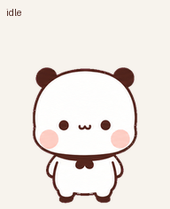

# Yier 🐻

以一二表情包为参考制作的动画宠物，适用于支持 Pets 插件的 ChatGPT Work 环境。

## 使用素材

1. 下载 [`assets/yier-spritesheet-v2.png`](assets/yier-spritesheet-v2.png)。这张透明 PNG 是完整宠物精灵图，上传时请使用原文件，避免聊天软件压缩或重新缩放。
2. 在支持 Pets 插件的环境中上传图片，并说明：

   > 请使用 Pets 插件检查并导入附件中的 v2 宠物精灵图，命名为 Yier，展示动画预览，通过校验后创建并选中它。

3. 需要改名时，可以直接说：

   > 请把当前宠物重命名为 Yier。

## 动画规格

- 完整精灵图：1536 × 2288 像素，8 列 × 11 行。
- 每格：192 × 208 像素，透明背景。
- 前 9 行：待机、向右移动、向左移动、挥手、跳跃、失败反应、等待、工作、检查。
- 最后 2 行：16 个顺时针看向方向，000 为向上、090 为向右、180 为向下、270 为向左。
- 每行帧数：6、8、8、4、5、8、6、6、6、8、8。

文件摘要和规格见 [`pet.json`](pet.json)。

## 文件目录

- `assets/`：可导入的最终精灵图。
- `previews/`：转头循环、全部动作 GIF 与 MP4、跳跃衔接、接触表和方向检查图。
- `previews/states/`：9 种状态各自的 GIF。
- `sources/`：当前版本采用的生成源图、动作条和方向锚点。
- `validation/`：最终图集、色边处理、动作质量、方向和 Pets 格式检查记录。
- [`docs/tutorial.zh-CN.md`](docs/tutorial.zh-CN.md)：中文制作经验与显示差异说明。

## 已知细节

转头序列已修正耳朵不随头部转动的问题。157.5° 和 337.5° 两个接近垂直的斜向帧，水平方向提示较细微；连续播放检查确认方向一致，相关检查记录保留在 `validation/` 中。

大尺寸生成图缩小到宠物单帧后会损失部分细节，深色背景更容易显出边缘像素。下载的已保存精灵图与上传版逐像素一致；客户端额外缩放是否影响锯齿尚未验证。

本仓库记录的是个人制作的参考图衍生版本。
